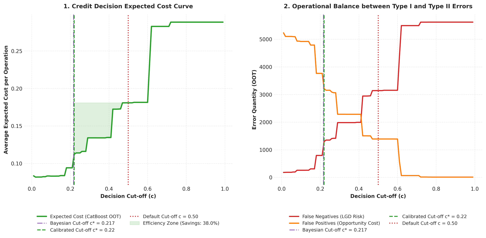

# Retail Credit Default Dynamics in Brazil
**Persistence, Regional Heterogeneity, and Predictive Modeling (2012-2026)**

## 📌 Executive Summary
This repository contains a comprehensive econometric and machine learning study on retail credit default in the Brazilian market. It moves beyond standard probability ranking by focusing on **decision threshold optimization based on asymmetric costs** (False Positives vs. False Negatives), translating statistical accuracy into actual capital efficiency and simulated financial loss mitigation.

## ⚙️ Core Methodology
* **Data Engineering (Out-of-Core):** Processing of anonymized microdata from the Central Bank of Brazil's Credit Information System (SCR).
* **Markov Chains (SLSQP Optimization):** Stochastic transition matrices tracking the inertia and steady-state equilibrium of delinquent balances across different macroeconomic regimes.
* **Predictive Modeling:** Out-of-Time ($t+12$ months) default forecasting comparing Baseline Persistence, Logistic Regression, Random Forest, and **CatBoost**.
* **Interpretability:** Directional impact extraction using **SHAP Values** to understand structural drivers like income brackets and occupational profiles.

## 📂 Repository Structure
All scripts, visualizations, and the final LaTeX reports are available in both **English** and **Portuguese**. 
* Files prefixed with `panel_` or `stage_` correspond to the English version.
* Files prefixed with `painel_` or `etapa_` correspond to the Brazilian Portuguese version.

*Note: Due to bank secrecy and data size constraints, the raw `.parquet` microdata is not included in this repository. The scripts provided generate all aggregations and visualizations assuming the presence of the base dataset.*

---
**Author:** Itaiguara de Oliveira Bezerra | Senior Data Economist
